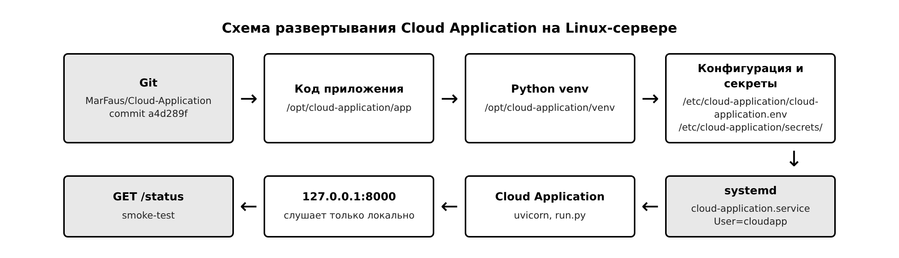

# ПМ.03 · Лабораторная работа №36. Развертывание серверного приложения

Cloud Application развёрнут на Linux без Docker как служба systemd: отдельный пользователь, venv, конфигурация и секреты вне Git, автозапуск, smoke-test и rollback.

**Результат: служба `cloud-application.service` active, процесс от `cloudapp`, порт `127.0.0.1:8000`, `/status` и `/docs` отвечают 200, rollback отработан, 47 ответов на контрольные вопросы.**

| Путь | Что внутри |
|---|---|
| [`ПМ03_Отчёт_ЛР-36_Развертывание_серверного_приложения.docx`](ПМ03_Отчёт_ЛР-36_Развертывание_серверного_приложения.docx) | Отчёт (25 страниц) |
| [`results/`](results) | Вывод всех команд, из которых сделаны скриншоты, и unit-файл |
| [`screenshots/`](screenshots) | Скриншоты терминала, схемы, Swagger UI |
| [`docs/operations/lr36-server-deployment.md`](docs/operations/lr36-server-deployment.md) | Эксплуатационная заметка |

## Как выполнялось

Все команды выполнены по тексту методических указаний на учебном стенде: Ubuntu 24.04.5, systemd как PID 1 в отдельном пространстве имён, Python 3.13. Вывод записан без правок. Развёрнута версия `a4d289f` репозитория [MarFaus/Cloud-Application](https://github.com/MarFaus/Cloud-Application).

## Особенности версии проекта

- В `requirements.txt` четыре пакета, SQLAlchemy и httpx нет, поэтому команда проверки импортов из методички закономерно завершается `ModuleNotFoundError`. Проверка выполнена и по фактическому составу зависимостей.
- В версии нет `alembic.ini` и `migrations/`.
- Ссылка `secrets` отображается в `git status`, в `.gitignore` проекта записи `secrets/` нет.
